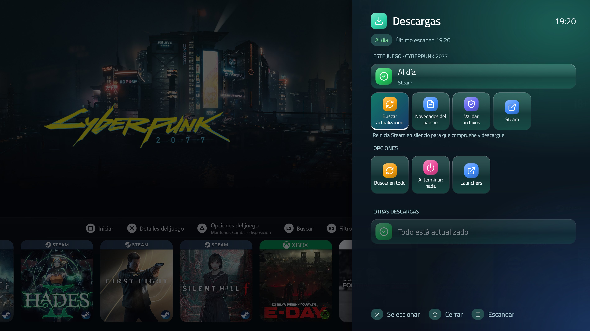
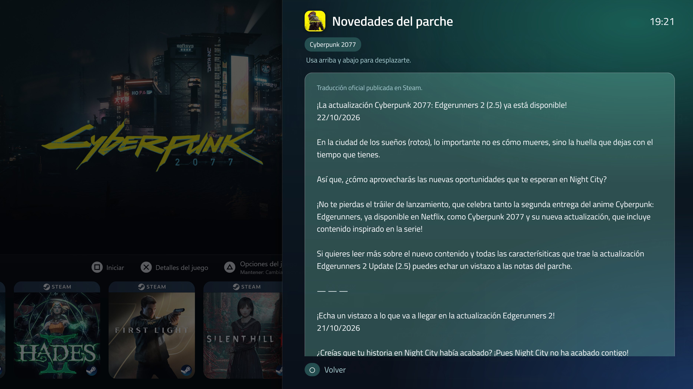

# Console Update Center

Plugin de [Playnite](https://playnite.link) que añade una pantalla de **Descargas** estilo consola al PC del salón: ves qué juegos tienen actualizaciones pendientes, sigues su progreso y haces que los launchers busquen actualizaciones, todo con el mando.

Del autor de [Console Overlay](https://github.com/galcn10/ConsoleOverlay): misma familia de filas de cristal, iconos y tipografía, con colores propios.

*[Read in English](README.md)*





## Funciones

- **Panel Descargas** (botón **Guía** en la pantalla de inicio): un panel lateral de cristal, como el centro de control de una consola, con Playnite oscurecido detrás. Actualizaciones pendientes, barras de progreso, velocidad y tiempo restante, y una acción para que todos los launchers busquen actualizaciones.
- **Se abre en el juego en el que estás**: si el foco está en una carátula o en la ficha de un juego, el panel empieza por ese juego; desde el hub o los menús muestra todas las descargas.
- **Ficha de cada juego**: estado, tamaño, *Buscar actualización*, *Novedades del parche* (Steam), *Validar archivos* (Steam) y acceso a su launcher.
- **Novedades del parche en tu idioma**: la traducción oficial de Steam si el estudio la publicó; si no, Google Translate (se puede desactivar).
- **Funciona con cualquier tema**: al seleccionar un juego con actualización aparece un aviso de cristal. No hay que tocar el tema.
- **Avisos de "Actualización completada"**, como en una consola. Si estás jugando, esperan a que vuelvas.
- **Pregunta antes de iniciar** un juego con actualización pendiente: *Actualizar primero* / *Jugar igualmente*.
- **Apagar o suspender al terminar las descargas**, con una cuenta atrás que se puede cancelar.
- **Aviso de falta de espacio** cuando una actualización no cabe en el disco del juego.
- **Arregla los "solo al iniciar"**: pasa esos juegos de Steam a *Mantener siempre actualizado* en un paso (se guarda copia de seguridad de cada ajuste).
- Aspecto propio (el verde agua y azul del logo) para no confundirse con Console Overlay, iconos de botones según tu mando (Xbox, PlayStation, Nintendo) y 15 idiomas.

## Plataformas

| Plataforma | Detección por juego | "Buscar en todo" |
|---|---|---|
| **Steam** | Sí: estado, tamaño, velocidad y tiempo restante | Reinicia Steam en silencio |
| **Epic Games** | Solo descargas a medias | Reinicia el launcher en silencio |
| **GOG Galaxy** | No | Reinicia Galaxy y lo minimiza |
| **Xbox / Microsoft Store** | No | Abre *Descargas y actualizaciones* |

El plugin nunca descarga parches por su cuenta: siempre deja que lo haga cada launcher, con tu cuenta y su DRM.

## Mando

- **Guía** (botón PS / Xbox) sobre un juego (su carátula o su ficha) abre el panel Descargas de ese juego. En el hub o en los menús no hace nada; el panel completo está en el menú principal.
- Con un juego abierto nunca reacciona, aunque hayas vuelto a Playnite con Console Overlay: ahí Guía te devuelve al juego.
- En los ajustes puedes elegir otro botón (mantener R3, L3, Select, Guía, o L1 + R1).

**A tener en cuenta**
- Playnite entrega cada pulsación al tema *y* a los plugins. Elige un botón que tu tema no use.
- **Mandos Xbox**: Windows abre la Xbox Game Bar con el botón Guía. Se desactiva en *Configuración › Juegos › Xbox Game Bar*.
- **Steam Input**: si Steam controla el mando, puede quedarse con el botón Guía. Cámbialo en los ajustes de mando de Steam o usa L1 + R1.

## Integración opcional con temas

Todo funciona sin tocar el tema. Si mantienes un tema y quieres más:

```xml
<!-- Insignia en la carátula de los juegos con actualización -->
<ContentControl x:Name="ConsoleUpdateCenter_UpdateBadge" />

<!-- Botón que abre Descargas, con el número de pendientes -->
<Button Command="{PluginSettings Plugin=ConsoleUpdateCenter, Path=OpenDownloadsCommand}"
        Content="{PluginSettings Plugin=ConsoleUpdateCenter, Path=PendingCount}" />
```

También: `HasPending`, `DownloadingCount`, `IsUpdating`, `UpdateAllCommand`.

Hay además un ajuste **experimental** que dibuja la insignia en las carátulas sin editar el tema.

## Para otros plugins

Tras cada escaneo, el plugin escribe `status.json` en su carpeta de datos (`ExtensionsData\6f3c2a7e-4b1d-4e8a-9c55-2d7f0b9a1e63`) con los juegos pendientes, su estado, progreso, velocidad y tiempo restante.

Además expone una pequeña API que usa [Console Overlay](https://github.com/galcn10/ConsoleOverlay) para abrir el panel desde su menú: `IntegrationApiVersion`, `IsPanelOpen`, `StatusFilePath`, `OpenPanel(gameId, onClosed)` y `ClosePanel()`.

## Requisitos

- Windows 10 u 11 · Playnite 10.
- Desarrollado y probado en modo Pantalla completa; el modo Escritorio funciona pero el panel está pensado para el mando.
- Para las *Novedades del parche* y su traducción hace falta conexión a Internet.

## Instalación

1. Descarga `ConsoleUpdateCenter_x_y_z.pext` de la página de [Releases](https://github.com/galcn10/ConsoleUpdateCenter/releases).
2. Ábrelo con doble clic (o arrástralo a Playnite). Playnite pide instalar y reiniciar.
3. Abre *Complementos → Ajustes de extensiones → Console Update Center*.

## Qué hace el plugin en tu sistema

Como actúa sobre otros programas, esto es exactamente lo que hace:

| Acción | Cómo | Para qué |
|---|---|---|
| Detectar actualizaciones de Steam | Lee (solo lectura) `appmanifest_*.acf` y `libraryfolders.vdf` | Estado, tamaño, progreso y velocidad |
| Detectar descargas de Epic | Lee (solo lectura) los manifiestos `.item` del launcher | Descargas a medias |
| Buscar actualizaciones | Cierra el launcher con normalidad y lo vuelve a abrir en silencio (`steam -shutdown` / `-silent`, Epic `-silent`, GOG Galaxy minimizado) | Que el launcher compruebe y descargue |
| Validar archivos | Abre `steam://validate/<appid>` | Lo hace Steam, no el plugin |
| "Mantener siempre actualizado" | Cambia `AutoUpdateBehavior` en el `.acf` de los juegos que elijas, con Steam cerrado y copia de seguridad previa | Arreglar los "solo al iniciar" |
| Novedades del parche | Consulta la API pública de eventos de Steam | Mostrar las notas del parche |
| Traducción | Envía el texto de las notas a Google Translate, solo si no hay traducción oficial y la opción está activa | Leerlas en tu idioma |
| Etiquetas | Añade la etiqueta que configures a los juegos con actualización (desactivado por defecto) | Filtrar en Playnite |
| Apagar / suspender | `shutdown /s` o la llamada estándar de suspensión, tras una cuenta atrás que puedes cancelar | Solo si lo eliges en el panel |

No descarga parches, no recoge datos, no toca los archivos de los juegos y no envía nada salvo las dos consultas anteriores. Todo lo que guarda está en su carpeta de datos.

## Limitaciones conocidas

- GOG Galaxy y Xbox / Microsoft Store no publican el estado de sus actualizaciones: el plugin solo puede pedir al launcher que compruebe.
- Epic solo muestra las descargas que ya empezaron.
- Para buscar actualizaciones hay que reiniciar el launcher; con un juego abierto el plugin no lo hace y te pide que lo cierres primero.
- Las notas del parche dependen de lo que publique cada estudio en Steam.

## Compilar desde el código

Requiere el .NET SDK. Desde esta carpeta:

```
dotnet build -c Release
```

La salida (`bin\Release`) contiene `ConsoleUpdateCenter.dll`, `extension.yaml`, `icon.png`, las fuentes, `LICENSE` y `THIRD-PARTY-NOTICES.txt`. Empaquétalo con el Toolbox de Playnite: `Toolbox.exe pack "bin\Release" "out"`.

## Idiomas

Español, inglés, francés, alemán, portugués, italiano, ruso, chino simplificado y japonés. Polaco, turco, coreano, neerlandés, ucraniano y chino tradicional están en **beta** (sin revisar). Puedes corregir o ampliar cualquiera sin recompilar: crea `lang\<código>.txt` en la carpeta de datos del plugin, con una línea por texto (`original<TAB>traducción`).

## Apoyo

Console Update Center es gratuito y de código abierto. Si te resulta útil, puedes apoyar el proyecto en Ko-fi. Los fallos e ideas en [Issues](https://github.com/galcn10/ConsoleUpdateCenter/issues) son igual de bienvenidos.

[](https://ko-fi.com/P3A629E34D)

## Licencia y créditos

Licencia MIT — Copyright (c) 2026 galcn10. Ver [LICENSE](LICENSE).

Componentes de terceros en [THIRD-PARTY-NOTICES.txt](THIRD-PARTY-NOTICES.txt): iconos de [Lucide](https://lucide.dev) (ISC) y fuentes Inter y Nunito (SIL Open Font License 1.1).

## Marcas

"Steam" es marca de Valve; "Epic Games" es marca de Epic Games; "GOG" y "GOG Galaxy" son marcas de CD PROJEKT; "Xbox" y "Microsoft Store" son marcas de Microsoft; "PlayStation" es marca de Sony Interactive Entertainment; "Nintendo" es marca de Nintendo; "Google Translate" es marca de Google. Se mencionan solo para indicar con qué programas es compatible. Este proyecto no está afiliado, respaldado ni patrocinado por ninguno de ellos y no usa sus logotipos.
