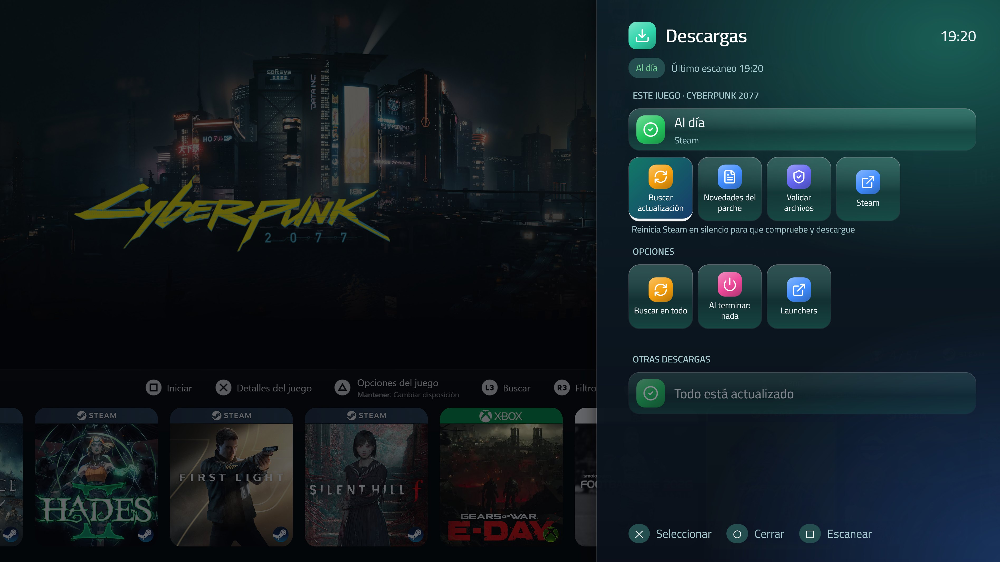
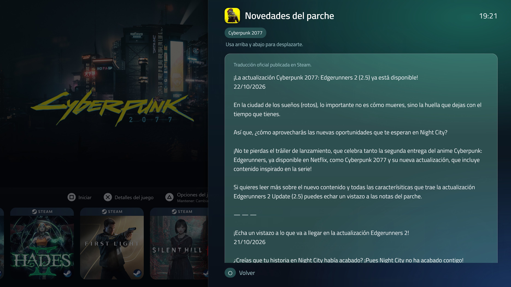

# Console Update Center

A [Playnite](https://playnite.link) plugin that brings a console-style **Downloads** screen to your living-room PC: see which games have pending updates, follow their progress and make your launchers check for updates — all with a controller.

Made by the author of [Console Overlay](https://github.com/galcn10/ConsoleOverlay): same family of glass rows, icons and fonts, with its own colors.

*[Leer en español](README.es.md)*





## Features

- **Downloads panel** (press the **Guide** button on the home screen): a glass side panel, like a console's control center, with Playnite dimmed behind it. Pending updates, progress bars, speed and time left, and one action to make every launcher check for updates.
- **Opens on the game you're on**: if a cover or game page has the focus, the panel starts with that game; from the hub or menus it shows all downloads.
- **Per-game sheet**: status, size, *Check for update*, *Patch notes* (Steam), *Verify files* (Steam) and a shortcut to the game's launcher.
- **Patch notes in your language**: the official Steam translation when the studio published one, otherwise Google Translate (can be turned off).
- **Works with any theme**: a glass notice appears when you select a game with an update. Nothing to edit in your theme.
- **"Update complete" notices**, like on a console. If you're playing, they wait until you're back.
- **Ask before launching** a game with a pending update: *Update first* / *Play anyway*.
- **Shut down or sleep when downloads finish**, with a cancellable countdown.
- **Low disk space warning** when an update won't fit on the game's drive.
- **Fix "only update when launched"**: switch those Steam games to *Always keep this game updated* in one step (a backup of each setting is kept).
- Its own look (the logo's teal-to-blue colors) so it never gets confused with Console Overlay, button icons that match your controller (Xbox, PlayStation, Nintendo), and 15 languages.

## Platforms

| Platform | Per-game detection | "Check all" |
|---|---|---|
| **Steam** | Yes: status, size, speed and time left | Restarts Steam quietly |
| **Epic Games** | Unfinished downloads only | Restarts the launcher quietly |
| **GOG Galaxy** | No | Restarts Galaxy and minimizes it |
| **Xbox / Microsoft Store** | No | Opens *Downloads and updates* |

The plugin never downloads patches by itself: it always lets each launcher do it, with your account and DRM.

## Controller

- **Guide** (PS / Xbox button) on a game (its cover or its page) opens the Downloads panel for that game. On the hub or in menus it does nothing; the full panel is in the main menu.
- While a game is open it never reacts, even if you went back to Playnite with Console Overlay: there, Guide returns to the game.
- You can choose another button in the settings (hold R3, L3, Select, Guide, or L1 + R1).

**Heads-up**
- Playnite sends every button press to the theme *and* to plugins. Pick a button your theme doesn't use.
- **Xbox controllers**: Windows opens the Xbox Game Bar with the Guide button. Turn it off in *Settings › Gaming › Xbox Game Bar*.
- **Steam Input**: if Steam controls your controller, it may take the Guide button. Change it in Steam's controller settings, or use L1 + R1.

## Optional theme integration

Everything works without touching your theme. If you maintain a theme and want more:

```xml
<!-- Badge on the cover of games with an update -->
<ContentControl x:Name="ConsoleUpdateCenter_UpdateBadge" />

<!-- Button that opens Downloads, with the pending count -->
<Button Command="{PluginSettings Plugin=ConsoleUpdateCenter, Path=OpenDownloadsCommand}"
        Content="{PluginSettings Plugin=ConsoleUpdateCenter, Path=PendingCount}" />
```

Also available: `HasPending`, `DownloadingCount`, `IsUpdating`, `UpdateAllCommand`.

There is also an **experimental** setting that draws the badge on covers without editing the theme.

## For other plugins

After every scan, the plugin writes `status.json` in its data folder (`ExtensionsData\6f3c2a7e-4b1d-4e8a-9c55-2d7f0b9a1e63`) with the pending games, their status, progress, speed and time left.

It also exposes a small API that [Console Overlay](https://github.com/galcn10/ConsoleOverlay) uses to open the panel from its menu: `IntegrationApiVersion`, `IsPanelOpen`, `StatusFilePath`, `OpenPanel(gameId, onClosed)` and `ClosePanel()`.

## Requirements

- Windows 10 or 11 · Playnite 10.
- Developed and tested in Fullscreen mode; Desktop mode works, but the panel is designed for a controller.
- *Patch notes* and their translation need an Internet connection.

## Install

1. Download `ConsoleUpdateCenter_x_y_z.pext` from the [Releases](https://github.com/galcn10/ConsoleUpdateCenter/releases) page.
2. Double-click it (or drag it onto Playnite). Playnite asks to install and restart.
3. Open *Add-ons → Extensions settings → Console Update Center*.

## What the plugin does on your system

Because it acts on other programs, here is exactly what it does:

| Action | How | Why |
|---|---|---|
| Detect Steam updates | Reads (read-only) `appmanifest_*.acf` and `libraryfolders.vdf` | Status, size, progress and speed |
| Detect Epic downloads | Reads (read-only) the launcher's `.item` manifests | Unfinished downloads |
| Check for updates | Closes the launcher normally and reopens it quietly (`steam -shutdown` / `-silent`, Epic `-silent`, GOG Galaxy minimized) | Let the launcher check and download |
| Verify files | Opens `steam://validate/<appid>` | Steam does it, not the plugin |
| "Always keep this game updated" | Changes `AutoUpdateBehavior` in the `.acf` of the games you choose, with Steam closed and a backup first | Fix "only update when launched" |
| Patch notes | Queries Steam's public events API | Show the patch notes |
| Translation | Sends the patch-notes text to Google Translate, only when there is no official translation and the option is on | Read them in your language |
| Tags | Adds the tag you configure to games with an update (off by default) | Filter in Playnite |
| Shut down / sleep | `shutdown /s` or the standard suspend call, after a countdown you can cancel | Only if you choose it in the panel |

It does not download patches, collect data, modify game files, or send anything other than the two queries above. Everything it stores lives in its data folder.

## Known limitations

- GOG Galaxy and Xbox / Microsoft Store don't expose their update status: the plugin can only ask the launcher to check.
- Epic only shows downloads that have already started.
- Checking for updates requires restarting the launcher; while a game is open the plugin won't do it and asks you to close the game first.
- Patch notes depend on what each studio publishes on Steam.

## Build from source

Requires the .NET SDK. From this folder:

```
dotnet build -c Release
```

The output (`bin\Release`) contains `ConsoleUpdateCenter.dll`, `extension.yaml`, `icon.png`, the fonts, `LICENSE` and `THIRD-PARTY-NOTICES.txt`. Pack it with Playnite's Toolbox: `Toolbox.exe pack "bin\Release" "out"`.

## Languages

Spanish, English, French, German, Portuguese, Italian, Russian, Simplified Chinese and Japanese. Polish, Turkish, Korean, Dutch, Ukrainian and Traditional Chinese are **beta** (unreviewed). You can fix or extend any of them without recompiling: create `lang\<code>.txt` in the plugin's data folder with one line per text (`original<TAB>translation`).

## Support

Console Update Center is free and open source. If you enjoy it, you can support the project on Ko-fi. Bug reports and ideas in [Issues](https://github.com/galcn10/ConsoleUpdateCenter/issues) are just as welcome.

[](https://ko-fi.com/P3A629E34D)

## License and credits

MIT License — Copyright (c) 2026 galcn10. See [LICENSE](LICENSE).

Third-party components and notices are in [THIRD-PARTY-NOTICES.txt](THIRD-PARTY-NOTICES.txt): [Lucide](https://lucide.dev) icons (ISC) and the Inter and Nunito fonts (SIL Open Font License 1.1).

## Trademarks

"Steam" is a trademark of Valve; "Epic Games" is a trademark of Epic Games; "GOG" and "GOG Galaxy" are trademarks of CD PROJEKT; "Xbox" and "Microsoft Store" are trademarks of Microsoft; "PlayStation" is a trademark of Sony Interactive Entertainment; "Nintendo" is a trademark of Nintendo; "Google Translate" is a trademark of Google. They are mentioned only to say which programs are compatible. This project is not affiliated with, endorsed by or sponsored by any of them. It does not use their logos.
